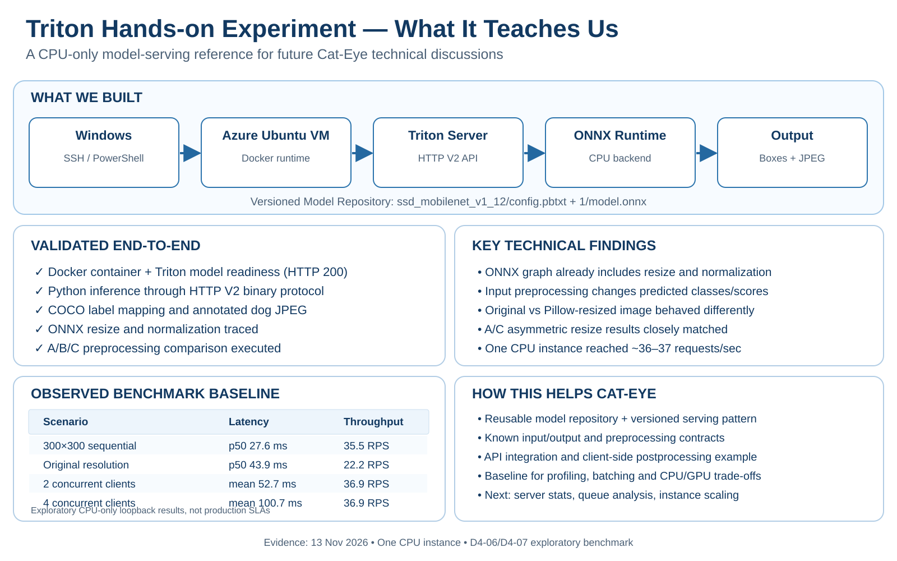
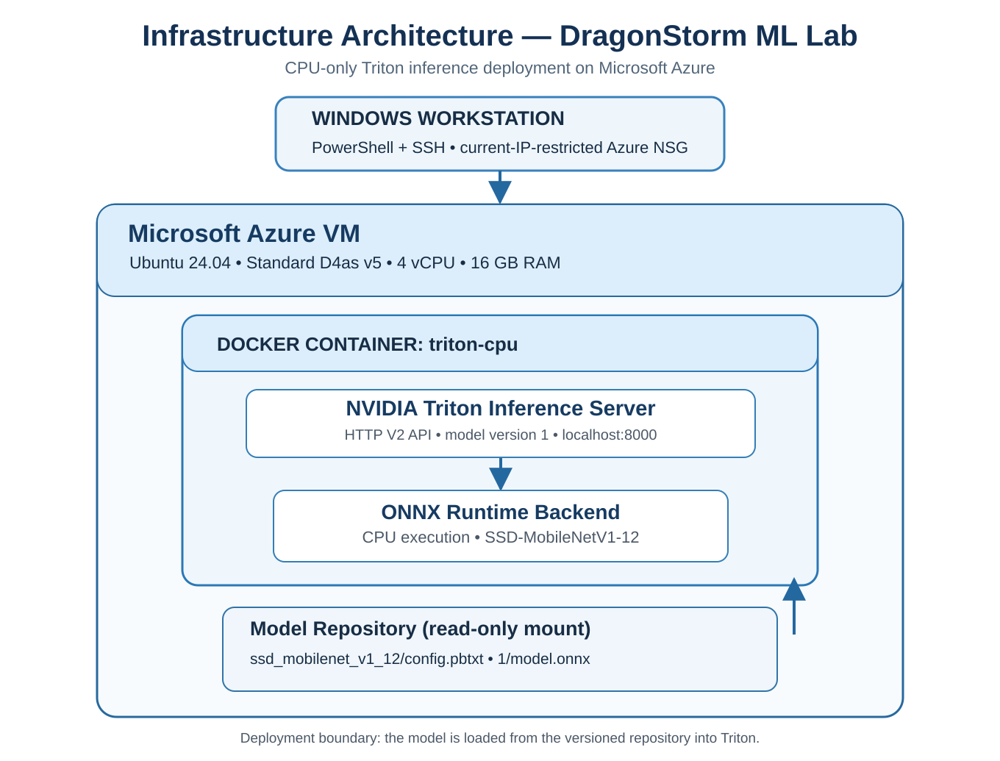
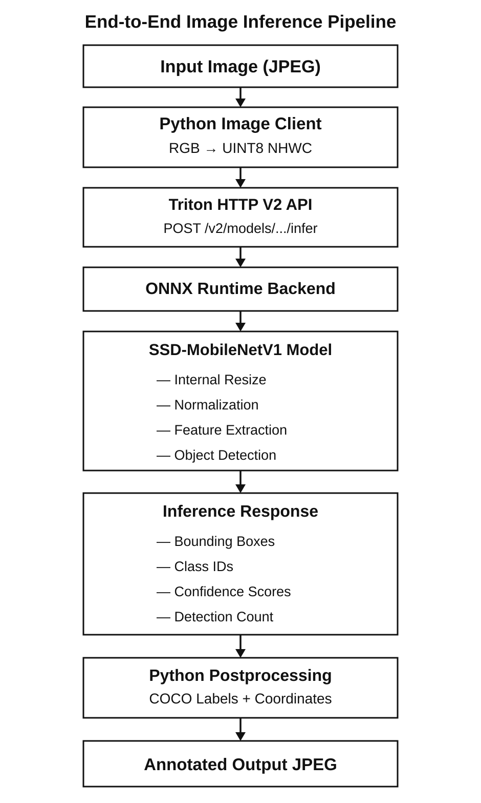

# DragonStorm Triton Lab — Architecture and concept diagrams

These diagrams are **GitHub-hosted SVG illustrations** recreated from three visual explanations produced during the DragonStorm Triton lab discussion. They capture the same architecture, inference sequence and learning summary as the original conversation images in a version-control-friendly, zoomable format. **They are not pixel-identical exports of the original generated PNGs.**

The architecture is based on the **independent personal Azure test environment**, not an implementation or deployment of the proprietary Cat-Eye project.

## 1. Experiment overview — why this matters for Cat-Eye

The lab demonstrates a small but complete CPU inference deployment: Windows workstation → Azure Linux VM → Dockerized Triton → ONNX Runtime CPU → structured object detections and annotated JPEG. The lower panels summarize validated checks, the preprocessing observation and the November 13 exploratory performance baseline.

**Use with Vijay/team:** This illustrates the reusable Triton serving pattern, input/output contract, model repository structure, HTTP protocol and the questions to investigate before a Cat-Eye-specific integration. It is not evidence that Cat-Eye already uses this exact architecture.

## 2. Infrastructure architecture

**Actual lab topology:**
- Windows PowerShell connects by SSH using an Azure NSG rule restricted to the **current source IP**.
- Personal Azure VM: Ubuntu 24.04, Standard D4as v5 (4 vCPU / 16 GiB).
- Docker container `triton-cpu` runs NVIDIA Triton 2.74.0 and a CPU ONNX Runtime backend. Inference HTTP service was exposed to the **host loopback only**, `127.0.0.1:8000`.
- The read-only-mounted, versioned model repository includes `ssd_mobilenet_v1_12/config.pbtxt` and `ssd_mobilenet_v1_12/1/model.onnx`. The model weights remain on the VM, **not in GitHub**.

**Design nuance:** The model repository is mounted for the server to load, while the inference *data flow* passes through the Triton API and its ONNX Runtime backend. It is not a sequential inference network hop.

## 3. End-to-end image inference flow (black and white)

**Execution sequence:**
1. Load JPEG and create RGB `UINT8` channels-last `[N,H,W,3]` array in Python (using Pillow + NumPy).
2. Serialize inference request using Triton's V2 HTTP binary tensor protocol and POST to `/v2/models/ssd_mobilenet_v1_12/infer`.
3. Triton routes to the ONNX Runtime CPU backend and loaded SSD-MobileNetV1-12 model.
4. The ONNX graph includes internal linear/asymmetric resize and normalization (`pixel × 0.007843138 − 1`) before feature extraction and SSD detection.
5. Triton returns the `FP32` tensors: `detection_boxes`, `detection_classes`, `detection_scores`, and `num_detections`.
6. Python client decodes COCO class labels and normalized bounding-box coordinates, renders red boxes/labels and writes an annotated JPEG.

**Caveat:** We investigated differing external resize implementations. The 300×300 Pillow input produced dog 96.94%, whereas the original-resolution input and an ONNX-style asymmetric external resize produced cat top-class scores around 80.5% on the same dog image. This is a *single-image preprocessing sensitivity finding*, not an accuracy study.

## 4. Observed initial serving performance

| Scenario | Request latency | Throughput |
| --- | ---: | ---: |
| 300×300 sequential, 30 requests | p50 27.624 ms; p95 30.251 ms | 35.49 RPS |
| Native 1546×1213, 30 requests | p50 43.938 ms; p95 45.976 ms | 22.19 RPS |
| 2 concurrent clients, 24 calls | mean 52.682 ms | 36.90 RPS |
| 4 concurrent clients, 24 calls | mean 100.722 ms | 36.85 RPS |

This one-CPU-instance, local-loopback client timing study found throughput plateaued near 36–37 RPS while request latency rose with concurrency. Queue causality is **not yet confirmed** by Triton server-side metrics. More samples and workload controls are needed for reliable capacity estimates.

## 5. Reproducible engineering references

- [Main documentation and roadmap](../README.md)
- [Progress tracker](PROGRESS.md)
- [Chronological experimental evidence](journal/2026-11-13-triton-preprocessing-benchmark.md)
- [Day 5 handoff: stats and scaling pending](journal/2026-11-17-day-5-handoff.md)
- [CPU benchmark results transcribed from observed stdout](experiments/2026-11-13-cpu-baseline.json)
- [Inference and preprocessing scripts](../scripts)
- [Operational SSH, security and shutdown procedures](OPERATIONS.md)

**Asset provenance and exclusions:** The three repository SVGs are reconstructed diagram illustrations from the images generated in this conversation. User-uploaded Azure Portal and PowerShell screenshots were **not** copied because they expose environment/account/network details. The public dog test photograph and annotated derivative were **not** copied pending appropriate reuse/license review; the original test artifact is documented as VM-local.
